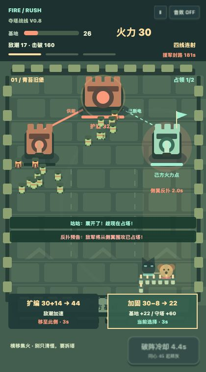

# V0.8 夺塔战线

## 方向修正

用户反馈 V0.7 仍像传统纵向飞行射击，缺少突破塔防的阵地感、密度与压力。因此删除持续滚动的护送路面、移动数学门和飞行弹幕 Boss，改为有明确空间归属的固定攻城战场。

最重要的变化不是怪物数值，而是兵源与阵地可以被玩家夺走：

1. 两座侧塔给主堡供能。未占塔时主堡免疫，占一座后仍减伤 82%，两座都占据才完全断电。
2. 拆塔不是自动获利。必须在该侧驻守 1.4 秒，且塔周围没有争夺者，才能转化己方火力点。
3. 占塔后该侧兵源关闭，自动塔开始清敌，给予主动转移进攻路线的窗口。
4. 敌方每轮反扑可从侧翼袭击已占塔。爆破手伤塔很重；塔被夺回时兵源和主堡供能恢复。继续集火主堡还是回援有真实后果。
5. 普通共振是和站位相关的局部震退、伤害与眩晕；同心满值扩大范围并破盾，不能无脑每几秒全屏清空。

三段主堡是同一套规则的连续推进，场景与敌军编制递进；没有额外塞入十个技能。主角墨墨负责集火与阵列进化，咕咕负责破阵和把敌方塔改造成己方防守点。

## 数学与成长

火力 22 起步，每 20 次击破回收一点，攻下主堡 +6，按 26 / 40 / 70 进化为四线、六线、八翼。数学补给在仍在战斗时结算：所在左右半边决定扩编、过载、加固、共筑等方案。乘法会加速兵潮；除法削弱己方阵列，换未来占塔的装甲；维修消耗真实火力，可能退档。费用不足明确取消，不会免费修复。

成长不再来自随机时间掉下来的卡片。主堡被攻破才进入下一阵地，不会因为打够时间就自动进入终局。200 秒仍未突破则援军封路。

## 原生手机输入契约

沿用主分支 ff9696e 的手机触控方向，并抽成可独立验证的 `src/input.js`：

- touchstart 在游戏区域识别一根活动手指；touchmove、touchend、touchcancel 在 window 上监听。
- 不缓存画布坐标，每次移动重新读取 bounding rect，因此浏览器地址栏伸缩引起尺寸变化后仍能映射。
- 按 identifier 匹配，不把技能的第二根手指当成移动结束，也不让技能起触接管移动。
- 不依赖 `setPointerCapture`。触摸派生 pointer 事件被忽略，避免双输入；桌面鼠标单独后备。
- 支持越界、松手续按、取消续按、空 changedTouches 的取消，以及缺失 touchend 后新手指重新接管。
- 技能 touchstart 即时触发，同时抑制随后兼容 click；按钮只占右下角 35%，包裹层不拦截其他区域。
- blur 只清输入，不自动弹暂停。切后台暂停模拟而非推进战斗，回来可重新起触。

这些是代码与事件回归验证结果，不等于已经在真实 iPhone Safari 或安卓微信内核完成验收。

## 实际验证边界

`tests/game.test.js` 验证供能、真实占领、争夺阻断、反夺、局部共振、补给代价、胜负和实体上限。`tests/input.test.js` 验证活动手指和按钮契约。浏览器测试进一步通过 TouchEvent / 同类合成触摸事件验证页面监听及 UI，完整回放不改资源、敌人或塔状态。

六个固定种子、左右不同开局策略的回放中，5 局通关，1 局在第一阵地失守；通关时间约 61–103 秒、峰值同时敌人 82–106。静止对照约 13 秒失守，扫射但不主动夺塔的策略也失败。固定种子 2 的完整浏览器回放：102.68 秒，击破 789，夺塔 9 次，其中 3 次为敌人反夺后的重新占领，基地余量 89.5。自动策略操作很强，这些结果只能证明可行路径和压力机制存在，不能当作真人胜率。

性能边界：最多 220 敌人、150 弹道轨迹、180 粒子，DPR 上限 2。当前三阵地、共享模拟规则；尚未做低端真机内存/帧耗时验收。微信小游戏宿主尚未接入。角色动画、美术细节、真人难度反馈仍有打磨空间。

## 交付前检查

- Node 22：22 项测试通过（14 项玩法 + 8 项输入），构建通过。
- 浏览器：12 项页面回归通过，控制台无 error/warn；原始记录与截图在 `tests/evidence/`。
- 320×568 独立构建：菜单完整，开始、暂停可用；未声称真实手机触屏已验收。
- 独立 HTML：30,821 字节，无图片 / 字体 / 音频外部下载。

