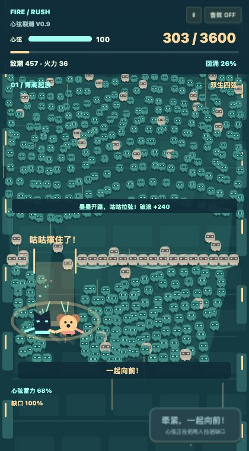
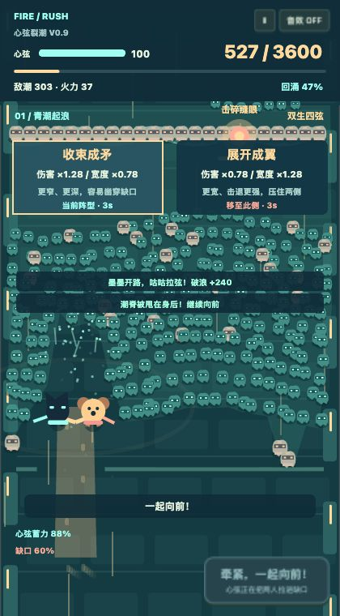

# V0.9 心弦裂潮 — 2026-10-28

## 为什么再推翻一次

V0.8 的固定夺塔让战场有了归属，但前进主要是关卡切换，敌人仍容易被读成一批批散兵。用户需要的是迎面蜂拥的压迫，以及亲手把角色带进敌潮的冲动。因此 V0.9 的核心动词改成“凿开、撑住、穿过”。

墨墨向游动的橙色缝眼集火，把横贯战场的潮脊凿出 3.6 秒开口；咕咕把两个人用心弦拉进裂口。成功承诺后咕咕会撑住这个开口，防止在冲锋中途无预警合拢。只打怪而不穿越，世界距离会被下一道潮脊卡住；反复硬闯则会损伤心弦。

完整路线为 3600 距离、六道潮脊和三重潮色，正常行走只前进 11 / 秒，必须主动破浪。干净缺口推进 240，拥堵硬闯最多 110，闭合潮脊会挡住硬闯，不允许穿墙。成功冲锋修复少量完整度、释放部分回涌压力；这些收益需要真正凿开路径。

## 蜂拥的实现

- 开局 625 个有生命、碰撞、掉落与位移状态的敌人，而非背景贴图或装饰数字；上限 760。
- 横向密集行列、群体前沿轮廓、流速周期与栅格分散，让它们读成一整片潮。射击产生的缺口会反映到真实前沿轮廓中。
- 视野前沿持续补潮。演示检查发现最初冲出去后前方会变空，已缩短补潮间隔并把入场位置放到前方视野边缘。
- 侧面漏过的敌人会变成回涌压力，限制移动空间并持续损伤心弦，不会免费消失。
- 重甲的体积、生命与缺口权重不同。后两重潮增加重甲比例与流速。

这里的“场上数量”是整个模拟视野附近的真实存活敌人，HUD 没有把它标为每一帧都可见的像素数量。界面遮挡与世界纵深会隐藏其中一部分。

## 向前冲的实现

冲锋持续 0.72 秒，角色的世界坐标实际穿过一段路径，路径上的敌人会被切开或推向两侧。镜头有受控的短暂跟随延迟，让角色先冲离原来的屏幕位置，再让世界追上来。地面砖缝、脚印、敌群、潮脊都使用同一个世界坐标与镜头映射，没有只滚动一张背景冒充位移。

没有继续扩充固定炮塔或飞行弹幕 Boss。胜利取决于六次真实穿越与累计前进距离，而非播放够时长。

## 数学选择融入心弦形状

收束：宽度 ÷1.28、单线伤害 ×1.28。展开：宽度 ×1.28、单线伤害 ÷1.28。宽度有 0.55–1.8 的实际边界，预览显示封顶后的有效倍率，伤害按有效宽度的倒数计算。

窄阵更容易凿穿缝眼，但放过更多侧翼；宽阵击退与覆盖更强，同时角色占用的缺口也更大。双方的距离、射击扇角、伤害、冲锋切开范围与接触范围都受这一数值影响，不是只有面板数字改变。

## 架构与性能边界

`src/v09/game.js` 是无 DOM 的种子化模拟；`main.js` 负责 Canvas、原生输入适配与菜单。敌人使用两张运行时生成并缓存的原创程序精灵，避免每帧为数百单位反复创建复杂路径。最多 760 敌人、130 射击轨迹、170 粒子，DPR 上限 2。

独立构建 30,287 字节，没有图片、字体或音频资源请求。演示截图和 GIF 是验证产物，不进入游戏包。尚未完成微信小游戏宿主与真实低端手机的帧耗时、内存、温度和触感验收；不把桌面浏览器回放当作这些验收。

## 实际验证

- Node：38 项测试通过，包括保留的 V0.8 回归、8 项输入契约与 16 项 V0.9 玩法检查。
- 浏览器：13 项检查通过。覆盖越界触摸、松手续按、空取消恢复、技能第二手指独立、暂停/继续、硬闯失败/重开、真实世界与镜头前推，以及六道潮脊的完整逃出生天。
- 种子 3 的完整策略回放：约 70.78 秒，前进 3604.74、击破 1146、14 次干净冲锋、0 次硬闯、心弦余量约 60.45、峰值 618 敌人。全过程没有恢复资源或删除敌人作弊。
- 六个固定种子的同一策略有 3 胜 3 负；不是声称六局全胜。站中路反复按冲锋的对照约 16.3 秒失败，静止与纯扫射也不能过关。自动策略不等于真人通关率或再玩意愿。
- 连续动图来自真实引擎每 1/30 秒推进一次后的页面截图，端点短暂停留方便观察。它是逐帧回放，不是真实手机实时录屏，也不是后期移动人物贴图。

原始统计与截图在 `tests/evidence-v09/`。浏览器 `/tests/browser-v09.html` 提供可复现的演示入口。

## 已知不足

目前是一个代表性原创玩法关卡，尚无外部玩家的压力感、可读性与二次开局反馈。窄阵/宽阵、窗口和难度仍需实际手机试玩调整。三重潮仍共享规则，场景叙事、角色动画与音效还比较轻量。

320×568 手机视口中的独立构建已检查菜单、开始与暂停，控制台未见 error/warn。线上预览仍需以发布后的实际访问为准。

