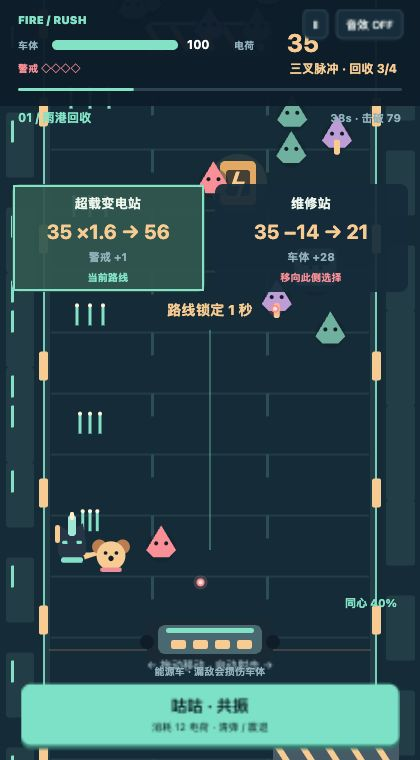

# V0.7 设计取舍

## V0.6 的问题来自闭环缺失

阅读原始单文件版本后发现：

1. 未撞到玩家的敌人会直接从屏幕下方移除，因此站在相对空的位置就能绕开大多数战斗。清场并不是胜利的必要条件。
2. 大部分数学门是两个纯收益的对比。火力有上限，乘法/加法也没有引入新的风险或资源占用。
3. 武器变化同时来自数学门、箱子和随机时间触发的强化卡，来源分散；高火力反过来消除操作要求。
4. 障碍物实质是可射击的收益箱或爆炸核心，没有挡路、挡弹或限时移位的约束。
5. 第 66 秒直接进入 Boss，前半段缺少需要玩家预期、承担并消化后果的节奏。

因此没有沿用随机强化卡、独立激光计时器和单纯追求更高火力的升级逻辑。

## 三种方向的取舍

- 三车道数学跑酷：输入最简单，但很容易把射击退化成选更大数字。
- 固定阵地防守：防线代价明确，但搭档容易成为装饰，移动空间不足。
- **双人移动护送**：后方能源车让漏敌有代价；搭档在前方移动清路；电荷把火力、修复与救急绑在一起。选择这条路线。

核心问题是“这 12 点电荷，现在留给墨墨升级，还是交给咕咕救场？”不是无限堆叠技能。击破四个普通敌人回收一点电荷，重甲额外回收两点，使成长可见且不至于几十秒就封顶。每个枪型对应弹道数、穿透与角色武器外观变化；电荷花掉后可以退档。

## 关卡结构

- 0–42 秒：雨港，学会清漏敌、绕开挡弹路障与第一处交换。
- 42–84 秒：水道，激光替代部分实体路障；除法换护盾，观察收益不等于最大的数字。
- 84–126 秒：高架，压力与资源累积；最后两处维修/超载影响 Boss 前状态。
- 126 秒起：封锁机甲，瞄准弹幕与车道扫射。扫射后 2.5 秒暴露核心，闭合装甲减伤 88%；80 秒未击破则能源耗尽失败。

六次岔路、三段视觉配色、四类敌人、可射爆电池、一个主动共振。没有局外养成、抽卡和十几个独立技能。重开动力来自路线和警戒不同、敌潮/路障位置变化、尝试以更少漏敌抵达灯塔；当前还没有足够的真人数据证明这种动力成立。

墨墨是薄荷围巾的黑猫射手；咕咕是珊瑚围巾的金色犬系守护者，始终在墨墨身边。共振消耗当前武器电荷、清弹震敌并短暂保护搭档，击破积累的同心值满时额外修车。搭档的依赖关系落实到战斗资源，没有只靠情侣台词表达。

## 验证方法与限制

自动策略每步读取战场，优先最靠近后方的敌人，避障和弹幕，必要时修车/共振。这是一条操作能力很强的可行路径，用来证明关卡没有必须作弊才能跨过的数值墙；不能当作普通玩家胜率。静止对照用于证明漏敌和碰撞确实能终止一局。

浏览器回归通过真实页面入口运行同一引擎和 UI，使用固定步长加速回放，不是实时真人试玩。浏览器测试中的资源没有被强制恢复。逻辑单测中个别生命周期测试会清空敌人以隔离触发条件，不能用于声称完整通关。

已知不足：

- 尚无外部真人留存、二次开局意愿与难度反馈；路线平衡仍是设计假设。
- 只有一个代表关卡；三段环境目前主要是色调与障碍组合变化，缺少独立场景叙事。
- 程序图形较轻量，角色动画和击打反馈仍可打磨；声音仅为可关闭的合成短音。
- 没有微信宿主、真实手机/低端设备性能验收；浏览器回放不代表这些验收通过。
- 简单圆形碰撞与每帧遍历足够当前实体上限，未来加倍规模需重新测量，不能直接外推。

## 本次实际验证记录（2026-10-27）

- `npm test`：13 项通过。
- `npm run balance`：种子 1–10 自动策略全部通关，142–146 秒，车体余量 64–89。种子 12 静止对照 27 秒失败。完整数据见 `tests/evidence/balance.json`。
- Codex 内置浏览器：10 项浏览器断言通过，含暂停时游戏时间不前进、触控指针与取消、失败重开、六处结算、完整胜利 UI。种子 7 的加速回放在 141.68 秒通关，击破 379、漏敌 1、车体 83；控制台无 error/warn。记录见 `tests/evidence/browser.txt` 与截图。
- 320×568 小屏：菜单主要内容和开始按钮均在视口内，独立构建可开始和暂停。固定 420×760 战场回放检查了路线与 Boss 镜头。未做真实手机触屏测试。
- `npm run build`：生成 28,136 字节的独立 HTML；无运行时依赖与外部素材。独立构建已在浏览器打开验证菜单、开始和暂停。未把模拟回放称为实时人工通关。

